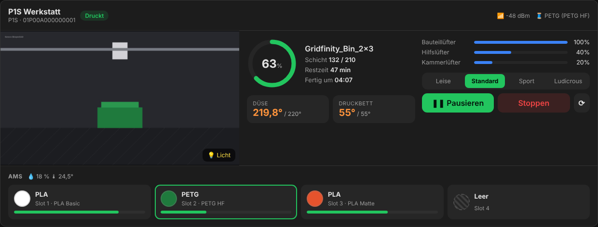
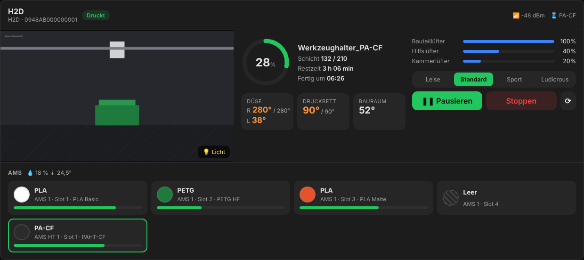
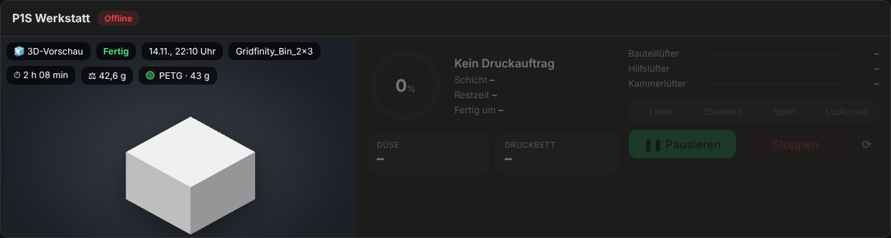
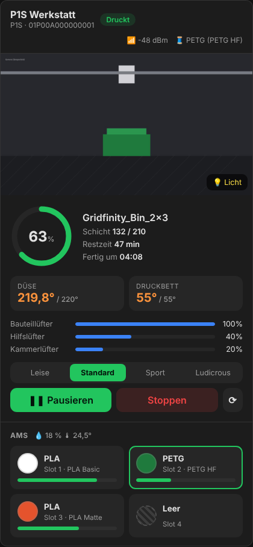

# MexMox Bambu Lab Bridge für Home Assistant

**Bambu-Lab-3D-Drucker lokal in Home Assistant – mit eigener Dashboard-Karte, Kamera, AMS, Steuerung, 3D-Vorschau und „Letzter Druck“. Ohne Cloud, ohne HACS.**



| H2D mit zwei Düsen, Bauraum und AMS HT | Drucker aus: 3D-Vorschau vom letzten Druck |
|---|---|
|  |  |

> Kein offizielles Produkt von Bambu Lab. „Bambu Lab“ und die Modellnamen sind Marken ihrer Inhaber.

---

## Inhalt

1. [Funktionen](#funktionen)
2. [Unterstützte Drucker](#unterstützte-drucker)
3. [So funktioniert es](#so-funktioniert-es)
4. [Voraussetzungen](#voraussetzungen)
5. [Installation als Home-Assistant-Add-on](#installation-als-home-assistant-add-on)
6. [Installation ohne Add-on (LXC, VM, Docker)](#installation-ohne-add-on-lxc-vm-docker)
7. [Konfiguration](#konfiguration)
8. [Entitäten in Home Assistant](#entitäten-in-home-assistant)
9. [Dashboard-Karte](#dashboard-karte)
10. [Dashboard in der Seitenleiste](#dashboard-in-der-seitenleiste)
11. [MQTT-Schnittstelle](#mqtt-schnittstelle)
12. [Beispiel-Automationen](#beispiel-automationen)
13. [Sicherheit und Datenschutz](#sicherheit-und-datenschutz)
14. [Fehlersuche](#fehlersuche)
15. [FAQ](#faq)
16. [Entwicklung und Tests](#entwicklung-und-tests)
17. [Bekannte Einschränkungen](#bekannte-einschränkungen)
18. [Lizenz](#lizenz)

---

## Funktionen

- **Live-Status:** Druckstatus, Fortschritt, Schicht, Restzeit und Fertig-Uhrzeit, Temperaturen von Düse, Bett und Bauraum, Lüfter, WLAN-Signal
- **Kamera** aller Serien, als Kamera-Entität in Home Assistant und in der Karte
- **AMS / AMS Lite / AMS HT:** Farben, Material, Marke, Restmenge, aktiver Slot, Feuchte und Temperatur
- **Steuerung:** Pausieren, Fortsetzen, Stoppen (mit Sicherheitsabfrage), Geschwindigkeit (Leise, Standard, Sport, Ludicrous), Kammerlicht, Status neu laden, optional G-Code
- **3D-Vorschau:** Das Vorschaubild aus Bambu Studio bzw. Orca Slicer wird beim Druckstart vom Drucker geladen, dazu Gewicht, geschätzte Druckzeit und Filamente
- **Letzter Druck:** Ist der Drucker aus, zeigt die Karte die 3D-Vorschau oder ein Foto vom Druckende, mit Ergebnis (Fertig, Fehlgeschlagen, Abgebrochen, Unterbrochen), Uhrzeit und Dauer
- **HMS-Fehlermeldungen** mit Link ins Bambu-Wiki
- **Eigene Dashboard-Karte** (`custom:bambu-printer-card`): passt sich hellem und dunklem Theme an, funktioniert auf Handy und Tablet, optional über die volle Breite
- **Dashboard in der Seitenleiste** (Ingress), ohne Token-Einrichtung
- **Mehrere Drucker** gleichzeitig
- **Automatische Einrichtung:** MQTT Discovery legt alle Entitäten selbst an. Das Add-on installiert die Karte und trägt sie als Dashboard-Ressource ein.
- **100 % lokal:** Die Kommunikation läuft direkt im LAN, ohne Bambu-Cloud

## Unterstützte Drucker

| Serie | Modelle (`model`) | Kamera | Bauraum-Temperatur | Besonderheiten |
|---|---|---|---|---|
| **P1** | `P1S`, `P1P` | Port 6000 (JPEG über TLS) | – | – |
| **A1** | `A1`, `A1MINI` | Port 6000 (JPEG über TLS) | – | AMS Lite ohne Feuchtesensor (wird ausgeblendet) |
| **X1** | `X1`, `X1C`, `X1E` | RTSPS Port 322 (über ffmpeg) | ✅ | – |
| **P2** | `P2S` | RTSPS Port 322 (über ffmpeg) | – | – |
| **H2** | `H2S`, `H2D`, `H2DPRO`, `H2C` | RTSPS Port 322 (über ffmpeg) | ✅ | H2D/H2D Pro/H2C: zwei Düsen, AMS HT |
| unbekannt | `OTHER` | wird automatisch per Port-Test erkannt | – | für künftige Modelle |

Status, Steuerung und Vorschau laufen bei allen Modellen über dieselben Schnittstellen: MQTT (Port 8883) und FTPS (Port 990). Unterschiedlich ist nur der Weg, über den die Kamera ihr Bild liefert.

**Teststand:** Alle Serien sind mit simulierten Druckern automatisch getestet (siehe [Entwicklung und Tests](#entwicklung-und-tests)). Mit einem echten Gerät erprobt ist der P1S. Rückmeldungen zu anderen Modellen sind sehr willkommen, gern als Issue.

## So funktioniert es

```
                 LAN (lokal, verschlüsselt)
 ┌──────────────┐  MQTT  :8883  ┌──────────────────┐  MQTT  ┌───────────────┐
 │ Bambu-Drucker│◄────────────► │  Bambu Bridge    │◄──────►│   Mosquitto   │
 │              │  FTPS  :990   │  (Add-on / LXC)  │        │   (Broker)    │
 │              │──────────────►│                  │        └───────┬───────┘
 │              │  Kamera       │ • Status → JSON  │                │ Discovery
 │              │  :6000 / :322 │ • Kamera → JPEG  │        ┌───────▼───────┐
 └──────────────┘──────────────►│ • Vorschau → PNG │        │Home Assistant │
                                │ • Befehle ← HA   │        │ Entitäten,    │
                                └──────────────────┘        │ Karte, Panel  │
                                                            └───────────────┘
```

1. Die Bridge meldet sich mit dem **Access Code** direkt am Drucker an (Benutzer `bblp`).
2. Der Drucker sendet laufend Statusänderungen. Die Bridge setzt sie zum vollständigen Zustand zusammen und veröffentlicht ihn als JSON.
3. Per **MQTT Discovery** entstehen in Home Assistant automatisch ein Gerät und alle Entitäten.
4. Befehle aus HA oder der Karte gehen über MQTT an die Bridge und von dort an den Drucker.
5. Beim Druckstart lädt die Bridge die `.gcode.3mf` per FTPS und zieht daraus das Vorschaubild.
6. Bei Druckende speichert sie ein Kamerafoto. Vorschau und Foto bleiben auch nach einem Neustart erhalten.

## Voraussetzungen

**Am Drucker:**
1. Den **LAN-Modus** einschalten (*Einstellungen → WLAN/Netzwerk*). Der **Access Code** steht im selben Menü.
2. Den **Developer Mode** einschalten, falls du den Drucker steuern willst (Licht, Pause, Geschwindigkeit, Stopp). Aktuelle Firmware lehnt Befehle von Fremd-Software sonst ab, nur das Mitlesen funktioniert dann.
   > ⚠️ Bei aktivem Developer Mode schließt Bambu Lab den Support aus. Bitte selbst abwägen.
3. Die **Seriennummer** notieren (*Einstellungen → Gerät*).
4. Für den Drucker eine **feste IP-Adresse** im Router einrichten (DHCP-Reservierung).
5. Nur **X1/H2/P2:** zusätzlich **„LAN Mode Liveview“** bzw. „LAN Only Liveview“ aktivieren, sonst gibt es kein Kamerabild.

**In Home Assistant:**
- Das Add-on **Mosquitto broker** installieren und starten. Die Integration **MQTT** muss eingerichtet sein.
- Für das Add-on: **Home Assistant OS** oder **Supervised**. Läuft HA als *Container* oder *Core*, nimm die [Variante ohne Add-on](#installation-ohne-add-on-lxc-vm-docker).
- Ab HA **2025.10** funktioniert alles ohne weitere Einstellung. Ältere Versionen siehe `legacy_object_id`.

## Installation als Home-Assistant-Add-on

[](https://my.home-assistant.io/redirect/supervisor_add_addon_repository/?repository_url=https%3A%2F%2Fgithub.com%2FDEIN-GITHUB-NAME%2Fbambu-p1s-homeassistant)

1. *Einstellungen → Add-ons → Add-on-Store → ⋮ (oben rechts) → Repositories* öffnen, diese URL einfügen und **Hinzufügen** klicken:
   ```
   https://github.com/DEIN-GITHUB-NAME/bambu-p1s-homeassistant
   ```
2. **„Bambu Lab Bridge“** öffnen und **Installieren** klicken. Der erste Build dauert ein paar Minuten.
3. Im Tab **Konfiguration** den Drucker eintragen: `model`, `host` (IP), `serial`, `access_code`. Dann **Speichern**.
4. **Starten** klicken. Im Tab **Protokoll** sollte erscheinen:
   ```
   Dashboard-Karte als Ressource eingetragen: /local/bambu/bambu-printer-card.js?v=…
   Mit Home-Assistant-Broker verbunden
   [P1S] Mit Drucker verbunden
   [P1S] Kamera verbunden (chamber)
   ```
5. Unter *Einstellungen → Geräte & Dienste → MQTT* steht jetzt das Gerät **„Bambu P1S“**.
6. Hat das Add-on den Ordner `www` neu angelegt (Hinweis im Protokoll), Home Assistant **einmal neu starten**.

Optional: Im Tab *Info* die Option **„In Seitenleiste anzeigen“** aktivieren. Dann erscheint der Menüpunkt **„3D-Drucker“**.

**Updates:** Sobald es eine neue Version gibt, zeigt Home Assistant das Update an. Die Karte wird dabei automatisch mitaktualisiert.

## Installation ohne Add-on (LXC, VM, Docker)

Für HA Container/Core oder wenn die Bridge auf einem eigenen Server laufen soll, z. B. in einem Proxmox-LXC.

### Variante A: systemd (Debian/Ubuntu, empfohlen)
```bash
git clone https://github.com/DEIN-GITHUB-NAME/bambu-p1s-homeassistant.git
cd bambu-p1s-homeassistant/standalone
sudo bash install.sh                       # installiert nach /opt/bambu-bridge (inkl. ffmpeg)
sudo nano /opt/bambu-bridge/config.yaml    # Drucker + MQTT-Zugang eintragen
sudo systemctl restart bambu-bridge
journalctl -u bambu-bridge -f              # Log ansehen
```

### Variante B: Docker Compose
```bash
cd bambu-p1s-homeassistant/standalone
cp config.example.yaml config.yaml && nano config.yaml
docker compose up -d --build
docker logs -f bambu-bridge
```

**Passender LXC (Proxmox):** unprivilegiert, Debian 12, 1 Kern, 256 MB RAM (512 MB mit Docker), 4 GB Speicher, feste IP. Nesting brauchst du nur für Docker.

**Für MQTT** legst du in HA einen eigenen Benutzer an (*Einstellungen → Personen → Benutzer*) und trägst ihn in `config.yaml` unter `homeassistant:` ein.

**Die Karte kommt hier per Hand dazu:**
`bambu_bridge/www/bambu-printer-card.js` nach `/config/www/bambu/` kopieren und unter *Einstellungen → Dashboards → ⋮ → Ressourcen* die URL `/local/bambu/bambu-printer-card.js?v=1` als **JavaScript-Modul** hinzufügen.

## Konfiguration

### Add-on-Optionen

| Option | Standard | Beschreibung |
|---|---|---|
| `log_level` | `info` | `debug`, `info`, `warning`, `error` |
| `install_card` | `true` | Karte nach `/config/www/bambu/` kopieren und als Ressource eintragen |
| `printers` | – | Liste der Drucker (siehe unten) |
| `mqtt_host`, `mqtt_port`, `mqtt_username`, `mqtt_password` | leer | Nur nötig, wenn **nicht** das Mosquitto-Add-on genutzt wird |

### Optionen je Drucker

| Option | Pflicht | Standard | Beschreibung |
|---|---|---|---|
| `name` | ✅ | – | Anzeigename. Daraus entsteht die Entitäts-ID (`P1S` → `sensor.bambu_p1s_…`) |
| `model` | ✅ | `P1S` | `P1S`, `P1P`, `A1`, `A1MINI`, `X1`, `X1C`, `X1E`, `P2S`, `H2S`, `H2D`, `H2DPRO`, `H2C`, `OTHER` |
| `host` | ✅ | – | IP-Adresse des Druckers |
| `serial` | ✅ | – | Seriennummer |
| `access_code` | ✅ | – | Access Code aus dem LAN-Menü |
| `camera` | | `true` | Kamera einbinden |
| `camera_mode` | | `auto` | `auto` (je nach Modell), `chamber` (Port 6000) oder `rtsp` (Port 322) |
| `camera_interval` | | `2` | Sekunden zwischen zwei Kamerabildern in HA |
| `preview` | | `true` | 3D-Vorschau beim Druckstart per FTPS laden |
| `last_print_delay` | | `5` | Sekunden nach Druckende bis zum Foto „Letzter Druck“ |
| `last_print_light` | | `false` | Für das Foto kurz das Licht einschalten (Developer Mode nötig) |
| `pushall_interval` | | `300` | Abstand in Sekunden für einen vollständigen Status-Abgleich. Nicht unter 60, sonst ruckelt der P1 |
| `allow_gcode` | | `false` | Rohe G-Code-Befehle über MQTT erlauben (⚠️ nur wenn nötig) |

### Standalone: `config.yaml`
```yaml
log_level: INFO
homeassistant:
  host: 192.168.1.10      # IP von Home Assistant / Mosquitto
  port: 1883
  username: bambu
  password: "geheim"
printers:
  - name: P1S
    model: P1S
    host: 192.168.1.50
    serial: "01P00A000000000"
    access_code: "12345678"
  - name: Werkstatt X1C
    model: X1C
    host: 192.168.1.51
    serial: "00M00A000000000"
    access_code: "87654321"
http:                       # optional: MJPEG-Stream ohne HA (z. B. für OBS)
  enabled: false
  port: 8099
```

## Entitäten in Home Assistant

Die Beispiele gelten für einen Drucker mit dem Namen `P1S`. Bei anderem Namen ändert sich der Teil `p1s`.

| Entität | Typ | Inhalt |
|---|---|---|
| `sensor.bambu_p1s_status` | Sensor | Bereit, Vorbereitung, Druckt, Pausiert, Fertig, Fehlgeschlagen. **Alle Daten als Attribute** |
| `sensor.bambu_p1s_progress` | Sensor | Fortschritt in % |
| `sensor.bambu_p1s_remaining` | Sensor | Restzeit in Minuten |
| `sensor.bambu_p1s_end_time` | Zeitstempel | Voraussichtliches Druckende |
| `sensor.bambu_p1s_layer` / `_total_layers` | Sensor | aktuelle Schicht / Schichten gesamt |
| `sensor.bambu_p1s_file` | Sensor | Name des Druckauftrags |
| `sensor.bambu_p1s_nozzle_temp` / `_nozzle_target` | Temperatur | Düse Ist / Soll |
| `sensor.bambu_p1s_bed_temp` / `_bed_target` | Temperatur | Druckbett Ist / Soll |
| `sensor.bambu_p1s_chamber_temp` | Temperatur | Bauraum (nur X1/H2) |
| `sensor.bambu_p1s_nozzle1_temp` / `_nozzle2_temp` | Temperatur | rechte / linke Düse (nur H2D, H2D Pro, H2C) |
| `sensor.bambu_p1s_fan_part` / `_fan_aux` / `_fan_chamber` | Sensor | Lüfter in % |
| `sensor.bambu_p1s_active_filament` | Sensor | aktives Filament |
| `sensor.bambu_p1s_wifi` | Diagnose | WLAN-Signal in dBm |
| `binary_sensor.bambu_p1s_printing` | Binär | Druck aktiv |
| `binary_sensor.bambu_p1s_error` | Problem | Fehler / HMS-Meldung |
| `light.bambu_p1s_chamber_light` | Licht | Kammerlicht |
| `select.bambu_p1s_speed` | Auswahl | Leise / Standard / Sport / Ludicrous |
| `button.bambu_p1s_pause` / `_resume` / `_stop` / `_refresh` | Taste | Steuerung |
| `camera.bambu_p1s_camera` | Kamera | Live-Bild |
| `camera.bambu_p1s_preview` | Kamera | 3D-Vorschau des aktuellen bzw. letzten Auftrags |
| `camera.bambu_p1s_last_print` | Kamera | Foto vom letzten Druckende |

Vorschau und letzter Druck bleiben **verfügbar, wenn der Drucker aus ist**. Sie hängen nur davon ab, ob die Bridge läuft.

## Dashboard-Karte

Das Add-on richtet die Karte automatisch ein. Im Dashboard: *Bearbeiten → Karte hinzufügen → „MexMox Bambu Drucker“*, oder per YAML:

```yaml
type: custom:bambu-printer-card
entity: sensor.bambu_p1s_status
```

| Option | Standard | Beschreibung |
|---|---|---|
| `entity` | – | **Pflicht.** Statussensor des Druckers |
| `show_camera` | `true` | Kamerabereich anzeigen |
| `show_fans` | `true` | Lüfter anzeigen |
| `show_ams` | `true` | AMS anzeigen |
| `show_controls` | `true` | Steuerung anzeigen |
| `camera_refresh` | `2` | Sekunden zwischen zwei Kamerabildern |
| `full_width` | `false` | In der Sections-Ansicht über die volle Breite |
| `show_last_print` | `true` | Drucker aus → Vorschau bzw. Foto statt „Drucker offline“ |
| `offline_image` | `preview` | `preview` (3D-Vorschau) oder `camera` (Foto vom Druckende) |
| `camera`, `preview_camera`, `last_print_camera` | automatisch | Kamera-Entitäten von Hand festlegen |

**Volle Bildschirmbreite:**
- **Sections-Ansicht:** `full_width: true` setzen und in den Einstellungen der Ansicht die maximale Anzahl Abschnitte auf **1** stellen.
- **Panel-Ansicht:** Die Karte als einzige Karte einfügen, dann ist sie immer bildschirmbreit.

Ab 620 px Breite ist die Karte zweispaltig, ab 1100 px schaltet sie auf ein breites Layout. Auf dem Handy bleibt sie einspaltig:



**Mehrere Drucker:** Für jeden Drucker eine eigene Karte mit dem jeweiligen `entity` anlegen.

## Dashboard in der Seitenleiste

Das Add-on bringt eine eigenständige Dashboard-Seite mit. Sie erscheint als Menüpunkt **„3D-Drucker“** (Option „In Seitenleiste anzeigen“) und zeigt alle Drucker untereinander. Die Anmeldung übernimmt Home Assistant.

**In der Standalone-Variante:** `bambu_bridge/www/index.html` nach `/config/www/bambu/` kopieren und als Dashboard vom Typ **Webseite** mit der URL `/local/bambu/index.html` anlegen. Auf einem Tablet ohne HA-Sitzung trägst du über das ⚙️-Symbol die HA-URL und einen langlebigen Zugriffstoken ein.

## MQTT-Schnittstelle

Die Bridge lässt sich auch ohne Home Assistant nutzen, z. B. mit Node-RED oder eigenen Skripten.

| Topic | Richtung | Inhalt |
|---|---|---|
| `bambu/bridge/status` | → | `online` / `offline` (retained) |
| `bambu/<slug>/availability` | → | Drucker `online` / `offline` |
| `bambu/<slug>/state` | → | Vollständiger Zustand als JSON (retained) |
| `bambu/<slug>/camera` | → | JPEG-Bild |
| `bambu/<slug>/preview`, `…/preview_attr` | → | PNG + Metadaten der 3D-Vorschau (retained) |
| `bambu/<slug>/last_print`, `…/last_print_attr` | → | Foto + Metadaten vom letzten Druck (retained) |
| `bambu/<slug>/cmd/pause` · `resume` · `stop` · `refresh` | ← | `PRESS` |
| `bambu/<slug>/cmd/light` | ← | `ON` / `OFF` |
| `bambu/<slug>/cmd/speed` | ← | `1`–`4` oder `Leise` / `Standard` / `Sport` / `Ludicrous` |
| `bambu/<slug>/cmd/gcode` | ← | z. B. `G28`, nur mit `allow_gcode: true` |

Auszug aus `bambu/p1s/state`:
```json
{
  "name": "P1S", "model": "P1S", "status": "Druckt", "gcode_state": "RUNNING",
  "progress": 63, "remaining_min": 47, "end_time": "2026-11-15T14:30:00+00:00",
  "file": "Gridfinity_Bin_2x3", "layer": 132, "total_layers": 210,
  "nozzle_temp": 219.8, "nozzle_target": 220, "bed_temp": 55.0, "bed_target": 55,
  "chamber_temp": null, "nozzles": [], "speed_name": "Standard", "light": "on",
  "ams": [{"label": "AMS 1", "humidity": 18, "trays": [{"slot": 1, "type": "PLA", "color": "#FFFFFF", "remain": 80, "active": false}]}],
  "hms": [], "camera_type": "chamber"
}
```
Zeitangaben sind ISO-8601 in UTC. Home Assistant zeigt sie in deiner Zeitzone an.

## Beispiel-Automationen

**Push aufs Handy mit 3D-Vorschau, wenn der Druck fertig ist:**
```yaml
alias: 3D-Druck fertig
triggers:
  - trigger: state
    entity_id: sensor.bambu_p1s_status
    to: "Fertig"
actions:
  - action: notify.mobile_app_DEIN_HANDY
    data:
      title: "✅ Druck fertig"
      message: "{{ state_attr('sensor.bambu_p1s_status', 'file') }} ist fertig."
      data:
        image: /api/camera_proxy/camera.bambu_p1s_preview
```

**Warnung bei Fehlern:**
```yaml
alias: 3D-Drucker Fehler
triggers:
  - trigger: state
    entity_id: binary_sensor.bambu_p1s_error
    to: "on"
actions:
  - action: notify.mobile_app_DEIN_HANDY
    data:
      title: "⚠️ Drucker meldet einen Fehler"
      message: >
        Status: {{ states('sensor.bambu_p1s_status') }} –
        {{ state_attr('sensor.bambu_p1s_status', 'hms') | map(attribute='code') | join(', ') }}
```

**Licht bei Druckstart einschalten, 10 Minuten nach Druckende aus:**
```yaml
alias: 3D-Drucker Licht
triggers:
  - trigger: state
    entity_id: binary_sensor.bambu_p1s_printing
    to: "on"
    id: start
  - trigger: state
    entity_id: binary_sensor.bambu_p1s_printing
    to: "off"
    for: "00:10:00"
    id: ende
actions:
  - choose:
      - conditions: "{{ trigger.id == 'start' }}"
        sequence:
          - action: light.turn_on
            target: { entity_id: light.bambu_p1s_chamber_light }
    default:
      - action: light.turn_off
        target: { entity_id: light.bambu_p1s_chamber_light }
```

## Sicherheit und Datenschutz

- Alle Verbindungen zum Drucker laufen **lokal und verschlüsselt** (TLS). Es gehen keine Daten in die Cloud.
- Der Access Code steht nur im Add-on-Formular bzw. in deiner lokalen `config.yaml`. Die erzeugte Konfiguration ist nur für den Dienst lesbar.
- Das Dashboard in der Seitenleiste nimmt nur Anfragen vom Supervisor-Proxy an (Ingress). Ein offener Port entsteht dabei nicht.
- Der optionale HTTP-Server der Standalone-Variante (`http.enabled`) hat **keine Anmeldung**. Schalte ihn nur in vertrauenswürdigen Netzen ein.
- Rohe G-Code-Befehle sind standardmäßig gesperrt (`allow_gcode: false`).
- Lädst du das Projekt auf GitHub hoch, **niemals** eine echte `config.yaml` einchecken. Die `.gitignore` verhindert das bereits.

## Fehlersuche

| Problem | Ursache / Lösung |
|---|---|
| `Drucker hat Verbindung abgelehnt` | Access Code falsch. Er ändert sich beim Aus- und Einschalten des LAN-Modus |
| Werte kommen an, Befehle wirken nicht | **Developer Mode** am Drucker einschalten |
| `Kamera (RTSPS): … 401 Unauthorized` | Access Code prüfen |
| `Kamera (RTSPS): Connection refused` | X1/H2/P2: **LAN-Live-Ansicht** am Drucker einschalten |
| `ffmpeg nicht gefunden` | Standalone: `apt install ffmpeg`. Im Add-on ist ffmpeg schon enthalten |
| Kein Kamerabild beim P1/A1 | Port 6000 erreichbar? Es gehen nur wenige Kamera-Verbindungen gleichzeitig, also Bambu Studio bzw. Handy-App schließen |
| `Druckdatei für die Vorschau nicht gefunden` | Druck direkt von SD-Karte ohne 3MF oder aus der Cloud gestartet. Die Karte zeigt dann das Foto |
| Gerät erscheint nicht in HA | MQTT-Integration eingerichtet? Unter *MQTT → Konfigurieren → Topic `bambu/#` anhören* prüfen, ob Daten ankommen |
| `extra keys not allowed … default_entity_id` | HA älter als 2025.10. Standalone: `legacy_object_id: true` unter `homeassistant:` setzen |
| Karte: „Custom element doesn't exist“ | HA einmal neu starten, Browser mit Strg+F5 neu laden, in der App den Frontend-Cache leeren |
| Karte zeigt eine alte Version | Ressourcen-URL mit neuer Nummer `?v=…` versehen (das Add-on macht das automatisch) |

**Ausführliches Protokoll:** `log_level: debug` setzen. Dann erscheint jeder Befehl an den Drucker im Log.

**Netzwerk prüfen** (vom Rechner der Bridge aus):
```bash
nc -zv DRUCKER-IP 8883   # MQTT (alle Modelle)
nc -zv DRUCKER-IP 990    # FTPS (Vorschau)
nc -zv DRUCKER-IP 6000   # Kamera P1/A1
nc -zv DRUCKER-IP 322    # Kamera X1/H2/P2
```

## FAQ

**Brauche ich die Bambu-Cloud oder die Handy-App?**
Nein. Die Bridge spricht nur lokal mit dem Drucker. Bambu Studio, Orca Slicer und Bambu Handy funktionieren parallel weiter.

**Funktioniert es ohne Developer Mode?**
Ja, dann aber nur lesend: Status, Kamera, AMS, Vorschau und letzter Druck. Steuern kannst du den Drucker nicht.

**Kann ich mehrere Drucker anbinden?**
Ja. Lege in der Liste `printers` weitere Einträge an, jeweils mit eigenem Namen.

**Was passiert bei einem Update von Home Assistant oder des Add-ons?**
Die Entitäts-IDs bleiben gleich. Vorschau und letzter Druck sind gespeichert, die Karte wird automatisch aktualisiert.

**Vom LXC zum Add-on wechseln?**
Die alte Bridge stoppen (`systemctl disable --now bambu-bridge`) und das Add-on mit demselben Druckernamen einrichten. Entitäten, Karten und Automationen bleiben erhalten.

**Ist das eine HACS-Integration?**
Nein. Es ist ein eigenständiges Add-on bzw. ein eigener Dienst und nutzt nur Bordmittel von Home Assistant (MQTT Discovery).

## Entwicklung und Tests

```
repository.yaml               Add-on-Repository für Home Assistant
bambu_bridge/                 Add-on
  bridge.py                   Bridge: Drucker ⇄ MQTT, Kamera, FTPS, HTTP
  addon_launcher.py           Starter: Formular → Konfiguration, Karte installieren
  www/bambu-printer-card.js   Lovelace-Karte
  www/index.html              Dashboard (Seitenleiste / eigenständig)
  config.yaml, Dockerfile …   Add-on-Definition
standalone/                   Variante für LXC/VM/Docker
tests/                        Unit- und Integrationstests
docs/images/                  Screenshots
```

### Unit-Tests (59 Tests, ohne Netzwerk)
```bash
pip install -r tests/requirements-dev.txt
pytest tests/ -v
```
Die Unit-Tests prüfen:
- **Modelle:** Erkennung aller Modelle und Auswahl des Kamera-Typs
- **Statusdaten:** Normalisierung für P1S, A1 (AMS Lite), X1C (Bauraum) und H2D (zwei Düsen, AMS HT), das Zusammensetzen von Teil-Updates, HMS-Codes
- **Befehle:** alle Befehle, die G-Code-Sperre und das Verhalten bei getrenntem Drucker
- **Druckende:** Erkennung von Druckstart und Druckende, Speichern und Neuladen von „Letzter Druck“
- **3D-Vorschau:** Auslesen der 3MF und Suche der Datei auf dem Drucker
- **MQTT Discovery:** je Modell, auch im Legacy-Modus
- **HTTP/Ingress:** Auslieferung des Dashboards und Zugriffsbeschränkung
- **Konfiguration:** Prüfung der Konfiguration und des Add-on-Formulars

### Integrationstest (42 Prüfungen, echte Prozesse)
Der Integrationstest startet Mosquitto (als Drucker- und als HA-Broker), einen FTPS-Server, die Kamera (P1-Protokoll bzw. RTSPS über mediamtx), einen simulierten Supervisor und die Bridge über den Add-on-Starter. Danach prüft er den kompletten Ablauf für **P1S** und **X1C**: Verbindung, Discovery, Kamera, Vorschau, Ingress, Karten-Ressource, Befehle, Druckende und sauberes Beenden.

```bash
# Voraussetzungen (Debian/Ubuntu): mosquitto, openssl, ffmpeg, mediamtx v1.9.x
sudo apt install mosquitto openssl ffmpeg
sudo MEDIAMTX=/pfad/zu/mediamtx python3 tests/integration/run_integration.py all
```
Er braucht root, weil die Ports 322, 990 und 6000 privilegiert sind. Am besten lässt du ihn in einem Test-Container laufen.

### Beitragen
Fehler und Ideen bitte als Issue melden. Besonders hilfreich sind **Log-Auszüge von Modellen**, die noch nicht mit echter Hardware erprobt sind (X1, P2S, H2). Mit `log_level: debug` erscheinen Rohdaten im Log. Seriennummer und Access Code vor dem Teilen bitte schwärzen.

## Bekannte Einschränkungen

- **Echte Hardware:** Erprobt ist nur der P1S. Die übrigen Modelle sind mit simulierten Druckern nach dem dokumentierten Protokoll getestet.
- **H2-Serie:** Die Temperaturen der zwei Düsen und des Bauraums liest die Bridge aus einem neueren Datenformat. Bei abweichender Firmware kann eine Anzeige fehlen.
- **Vorschau:** Sie funktioniert nur, wenn der Druck als `.gcode.3mf` an den Drucker geschickt wurde, also aus Bambu Studio oder Orca Slicer.
- **Kamera:** Die Kamera der P1/A1-Serie liefert etwa 1 Bild pro Sekunde. Das ist eine Grenze der Hardware.
- **Firmware:** Ein künftiges Update von Bambu Lab kann den lokalen Zugriff verändern.

## Lizenz

[MIT](LICENSE) © 2026 MexMox. Die Nutzung erfolgt auf eigene Verantwortung. Für Schäden an Drucker, Drucken oder Daten wird keine Haftung übernommen.

Änderungen je Version stehen in [`bambu_bridge/CHANGELOG.md`](bambu_bridge/CHANGELOG.md).
